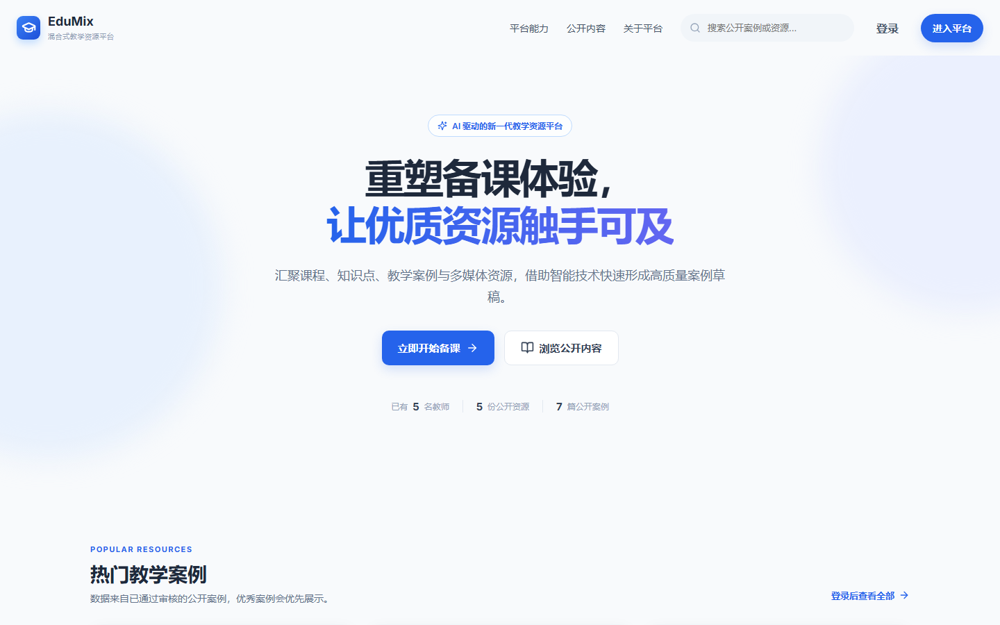
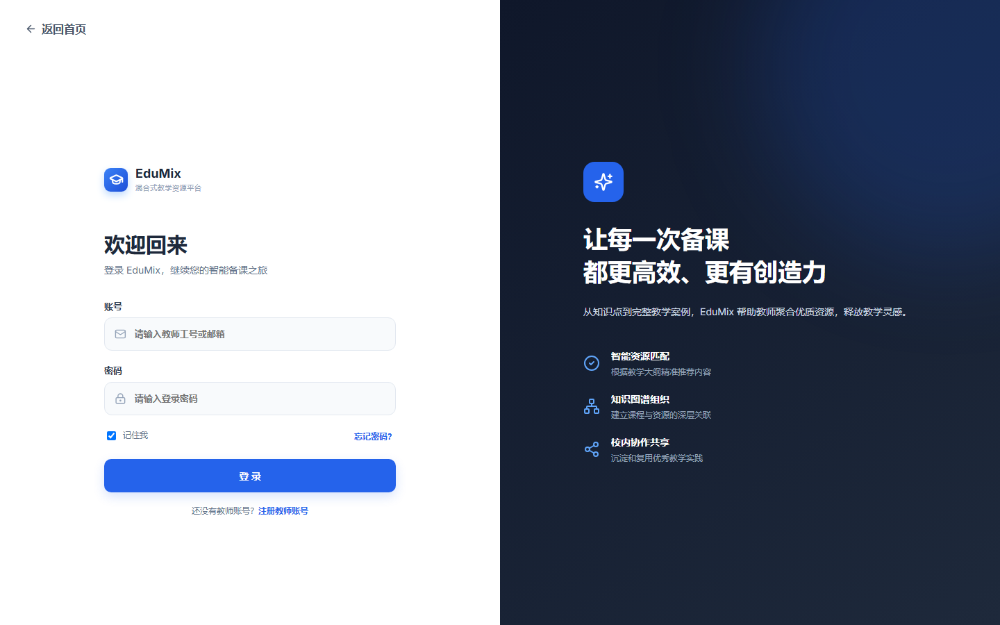

# EduMix 混合式教学资源平台

EduMix 是一个面向高校教师的混合式教学资源管理平台，采用 Vue 3 与 Spring Boot 前后端分离架构。系统围绕课程、章节和知识点组织教学资源与教学案例，并提供资源审核、富文本案例编写、积分激励、消息私信和 AI 辅助整合能力。

> 当前项目范围以教学资源库和教学案例库为核心，不包含资源包和授课方案模块。

## 系统界面

### 公共首页



### 登录页面



## 主要功能

- **用户与权限**：教师注册、JWT 登录与退出、个人资料、头像、密码修改以及管理员账号管理。
- **角色管理**：区分教师、资源负责人和管理员；资源负责人同时拥有教师业务权限。
- **课程体系**：按照“课程 → 章节 → 知识点”维护教学结构，并记录知识、能力、素质三个维度的课程目标。
- **教学资源库**：支持图片、PDF、MP4 和常用文档上传，以及分类、检索、预览、下载、收藏、纠错和重新提交审核。
- **教学案例库**：支持本地草稿、富文本编辑、图片和视频嵌入、资源引用、公开审核、优秀案例推荐和积分解锁。
- **审核中心**：资源负责人审核公共资源和案例；未通过内容保持非公开，作者可修改后再次提交。
- **积分系统**：注册奖励、每日签到、案例审核奖励、积分案例解锁、作者收入和管理员人工发放。
- **消息中心**：系统公告、审核结果、纠错通知和教师之间的实时私信。
- **个人主页**：展示用户资料、已发布资源与案例，并支持资料和头像维护。
- **AI 辅助**：从公共资源库和案例库推荐内容，或根据用户选择的收藏内容进行多轮对话与案例草稿整合。
- **公共门户**：无需登录即可查看真实平台统计、优秀案例摘要并搜索已审核的公开内容。

## 角色权限

| 功能                   | 教师 | 资源负责人 | 管理员 |
| ---------------------- | :--: | :--------: | :----: |
| 注册后使用教师功能     |  ✓   |     ✓      |   —    |
| 课程、章节、知识点管理 |  ✓   |     ✓      |   ✓    |
| 上传资源、编写案例     |  ✓   |     ✓      |   ✓    |
| 审核公共资源和案例     |  —   |     ✓      |   ✓    |
| 处理资源纠错           |  —   |     ✓      |   ✓    |
| 创建、停用和调整账号   |  —   |     —      |   ✓    |
| 发放积分               |  —   |     —      |   ✓    |
| 发布全服系统通知       |  —   |     —      |   ✓    |

## 技术栈

### 前端

- Vue `3.5`
- Vite `6`
- Vue Router `4`
- Axios
- Lucide Vue Next
- STOMP WebSocket

### 后端

- Java `17`
- Spring Boot `4.1.1`
- Spring Security、JWT
- Spring Web MVC、WebSocket
- MyBatis-Plus `3.5.17`
- Spring AI `2.0.1`
- Jsoup
- Maven

### 数据与存储

- MySQL 8 或更高版本
- 本地文件存储，后续可扩展为 MinIO 等对象存储

## 系统架构

后端统一使用以下调用方向：

```text
Vue 3
  ↓ HTTP / WebSocket
Controller
  ↓
Service
  ↓
ServiceImpl
  ↓
Mapper
  ↓
MySQL / 本地文件目录
```

Controller 不直接操作数据库；复杂查询通过领域 Mapper 或 `SqlQueryMapper` 完成。详细说明见 [后端分层说明](mixin-back/edumix/ARCHITECTURE.md)。

## 项目目录

```text
edumix/
├─ front/                              Vue 3 前端
│  ├─ src/api/                         后端接口封装
│  ├─ src/components/                  通用组件
│  ├─ src/layouts/                     应用布局
│  ├─ src/router/                      路由与前端权限守卫
│  ├─ src/styles/                      页面样式
│  └─ src/views/                       业务页面
├─ mixin-back/edumix/                  Spring Boot 后端
│  ├─ src/main/java/.../controller/    HTTP 接口层
│  ├─ src/main/java/.../service/       业务接口
│  ├─ src/main/java/.../service/impl/  业务实现
│  ├─ src/main/java/.../mapper/        数据访问层
│  ├─ src/main/java/.../entity/        数据库实体
│  ├─ src/main/java/.../dto/           请求与响应对象
│  ├─ src/main/resources/sql/          建表、迁移和演示数据脚本
│  ├─ src/test/                        后端自动化测试
│  └─ uploads/                         默认上传目录
├─ docs/screenshots/                   README 系统截图
├─ AI_SETUP.md                         AI 配置补充说明
├─ AUTH_API.md                         认证与权限说明
└─ DATABASE_DESIGN.md                  数据库设计说明
```

## 环境要求

- JDK 17
- Maven 3.9 或 IDE 内置 Maven
- Node.js 18 或更高版本
- npm 9 或更高版本
- MySQL 8 或更高版本
- IntelliJ IDEA 和 VS Code 均可，IDE 不影响前后端通信

## 数据库初始化

### 1. 创建数据库

```sql
CREATE DATABASE edumix
  DEFAULT CHARACTER SET utf8mb4
  COLLATE utf8mb4_0900_ai_ci;
```

### 2. 按顺序执行脚本

在仓库根目录打开 MySQL 客户端：

```sql
USE edumix;
SOURCE mixin-back/edumix/src/main/resources/sql/edumix_schema.sql;
SOURCE mixin-back/edumix/src/main/resources/sql/edumix_seed.sql;
SOURCE mixin-back/edumix/src/main/resources/sql/edumix_v2_migration.sql;
SOURCE mixin-back/edumix/src/main/resources/sql/edumix_auth_accounts.sql;
SOURCE mixin-back/edumix/src/main/resources/schema.sql;
```

以上脚本会建立当前系统所需的 22 张数据表、演示课程、资源、案例和三个测试账号。

如果数据库来自精简前的 31 表版本，请先备份，再执行一次：

```sql
SOURCE mixin-back/edumix/src/main/resources/sql/edumix_compact_migration.sql;
```

该脚本会先迁移审核历史、积分业务记录和私信已读位置，再删除 9 张被合并或停用的旧表；不要在已经精简完成的数据库上重复执行。

`application.yaml` 中设置了 `spring.sql.init.mode=always`，因此应用启动时还会重复执行可安全运行的 `schema.sql`，用于补充统一审核、私信和登录安全所需的字段与索引。

## 环境变量

后端配置模板位于 [mixin-back/edumix/.env.example](mixin-back/edumix/.env.example)。真实密码和 API Key 不得提交到 Git。

| 变量                | 是否必填   | 默认值或作用                                  |
| ------------------- | ---------- | --------------------------------------------- |
| `DB_URL`            | 否         | 默认连接 `jdbc:mysql://localhost:3306/edumix` |
| `DB_USERNAME`       | 否         | 默认 `root`                                   |
| `DB_PASSWORD`       | 是         | 本机 MySQL 密码                               |
| `JWT_SECRET`        | 是         | 至少 32 字节随机内容的 Base64 编码            |
| `AI_CHAT_PROVIDER`  | 启用 AI 时 | 设置为 `openai`；不配置时默认为 `none`        |
| `AI_API_KEY`        | 启用 AI 时 | AI 服务端密钥，只能配置在后端                 |
| `AI_BASE_URL`       | 否         | 默认 `https://api.openai.com`                 |
| `AI_CHAT_PATH`      | 否         | 默认 `/v1/chat/completions`                   |
| `AI_MODEL`          | 否         | 默认 `gpt-4o-mini`                            |
| `EDUMIX_UPLOAD_DIR` | 否         | 默认 `uploads`                                |

在 PowerShell 中生成 JWT 密钥：

```powershell
$randomBytes = New-Object byte[] 32
[Security.Cryptography.RandomNumberGenerator]::Create().GetBytes($randomBytes)
[Convert]::ToBase64String($randomBytes)
```

在 IDEA 中文界面中，可打开“运行 → 编辑配置”，选择 `EdumixApplication`，然后点击“修改选项 → 环境变量”填写上述变量。

## 测试账号

| 账号       | 密码     | 角色                          | 用途                             |
| ---------- | -------- | ----------------------------- | -------------------------------- |
| `teacher`  | `123456` | `TEACHER`                     | 课程、资源、案例、积分和 AI 功能 |
| `reviewer` | `123456` | `TEACHER`、`RESOURCE_MANAGER` | 教师业务、资源审核和案例审核     |
| `admin`    | `123456` | `ADMIN`                       | 账号、积分和系统通知管理         |

这些账号只用于本地联调。应用首次启动后会把演示密码迁移为 BCrypt，不会继续以明文形式存储。生产环境必须删除演示账号或强制修改密码。

## 启动后端

### PowerShell

```powershell
Set-Location "mixin-back/edumix"
$env:DB_USERNAME = "root"
$env:DB_PASSWORD = "你的MySQL密码"
$env:JWT_SECRET = "生成的Base64密钥"
mvn spring-boot:run
```

后端默认地址：`http://localhost:8080`。

### IntelliJ IDEA

1. 使用 IDEA 打开 `mixin-back/edumix`。
2. 等待 Maven 依赖加载完成。
3. 配置数据库、JWT 和可选的 AI 环境变量。
4. 运行 `com.itxiaowu.edumix.EdumixApplication`。

## 启动前端

```powershell
Set-Location "front"
npm install
npm run dev
```

前端默认地址：`http://localhost:5173`。

Vite 会把 `/api` 代理到 `http://localhost:8080`，把 `/ws` 代理到后端 WebSocket 服务，因此本地开发不需要 Nginx。

## AI 接口配置

AI 配置必须放在 Spring Boot 后端，不能写入 Vue 前端。使用 OpenAI 或兼容 OpenAI Chat Completions 的服务时，可在启动后端前设置：

```powershell
$env:AI_CHAT_PROVIDER = "openai"
$env:AI_API_KEY = "你的API Key"
$env:AI_BASE_URL = "https://api.openai.com"
$env:AI_MODEL = "gpt-4o-mini"
```

若第三方服务的请求路径不同，再配置 `AI_CHAT_PATH`。修改 AI 环境变量后必须重启后端。

未配置 AI 时，其他模块仍可正常运行，AI 页面会显示服务尚未配置。更多内容见 [AI_SETUP.md](AI_SETUP.md)。

## 文件上传目录

默认上传目录为后端运行目录下的：

```text
mixin-back/edumix/uploads/
```

MySQL 只保存文件名称、类型、大小、相对地址、上传者、可见范围和审核状态。上传文件本体不会存入数据库。

如需修改位置，设置：

```powershell
$env:EDUMIX_UPLOAD_DIR = "E:/edumix-uploads"
```

单文件默认上限为 200 MB，请确保目标目录存在且后端进程有读写权限。`uploads/` 已被 Git 忽略，不应提交用户上传内容。

## 常用地址

| 地址                                    | 说明                 |
| --------------------------------------- | -------------------- |
| `http://localhost:5173`                 | 公共首页             |
| `http://localhost:5173/login`           | 登录页面             |
| `http://localhost:5173/register`        | 教师注册页面         |
| `http://localhost:8080/api/public/home` | 公共首页真实统计接口 |
| `http://localhost:8080/api/ai/status`   | AI 配置状态接口      |
| `ws://localhost:8080/ws/chat`           | 私信 WebSocket 入口  |

## 测试与构建

### 后端测试

测试会连接 MySQL，请先创建并初始化 `edumix`，同时提供数据库密码和 JWT 密钥。

```powershell
Set-Location "mixin-back/edumix"
$env:DB_PASSWORD = "你的MySQL密码"
$env:JWT_SECRET = "生成的Base64密钥"
mvn test
```

当前后端包含 28 个自动化测试，覆盖账号权限、课程目标、资源关联、审核流程、案例草稿、积分、消息、AI候选范围及公共首页数据过滤。

### 后端代码格式

```powershell
mvn fmt:format
```

### 前端检查与构建

```powershell
Set-Location "front"
npm run format:check
npm run build
```

构建结果生成在 `front/dist`。

## 常见问题

### 启动时报 `JWT_SECRET` 缺失

后端要求 JWT 密钥必须通过环境变量提供。生成合法 Base64 密钥并重新启动应用。

### IDEA 提示找不到 `EdumixApplication`

重新加载 Maven 项目，执行“构建 → 重新构建项目”，并确认运行配置使用 `mixin-back/edumix` 模块的 classpath。

### IDEA 提示没有配置 SQL 方言

这是 IDE 编辑器提示，不影响 Spring Boot 运行。可在“设置 → 语言和框架 → SQL 方言”中选择 MySQL。

### AI 页面提示服务尚未配置

检查 `AI_CHAT_PROVIDER`、`AI_API_KEY`、`AI_BASE_URL` 和 `AI_MODEL` 是否配置在后端运行配置中，并在修改后重启 Spring Boot。

### 上传成功但找不到文件

相对路径 `uploads` 以 Spring Boot 的运行目录为基准。建议在 IDEA 中确认工作目录，或使用绝对路径配置 `EDUMIX_UPLOAD_DIR`。

## 安全说明

- 不要把数据库密码、JWT 密钥、AI API Key 写入源码或提交到 Git。
- 前端 `VITE_` 环境变量会进入浏览器构建产物，不能用于保存任何密钥。
- 公共接口只返回已审核且公开的摘要，不返回积分案例正文、服务器文件路径或用户隐私信息。
- 演示账号与默认密码只能用于本地联调。
- 正式部署时建议增加独立生产配置、HTTPS、对象存储和数据库备份。JWT 注销版本已持久化到 MySQL。

## 相关文档

- [数据库设计说明](DATABASE_DESIGN.md)
- [后端分层说明](mixin-back/edumix/ARCHITECTURE.md)
- [AI 配置说明](AI_SETUP.md)
- [认证与权限接口说明](AUTH_API.md)
- [前端说明](front/README.md)

- [收尾修复与验证（2026-10-19）](docs/finalization-validation.md)
